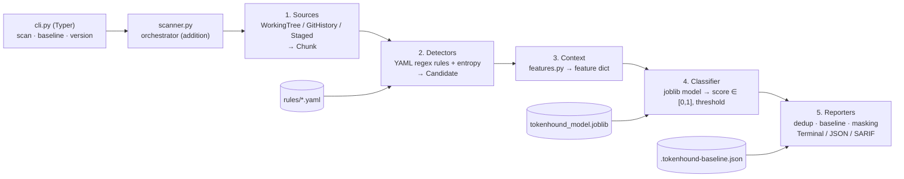

# Architecture

TokenHound is a local command-line tool: no server, database, API or authentication. The design
follows spec §5 (linear five-stage pipeline) and §11 (repository layout). Additions that are not in
the spec are marked *(addition)* and recorded in `docs/DECISIONS.md`.

## Pipeline



| Stage | Module(s) | Input → output | Milestone |
|---|---|---|---|
| 1. Sources | `sources/working_tree.py`, `git_history.py`, `staged.py` | path / repo → `Iterator[Chunk]` | H4, H5 |
| 2. Detectors | `detectors/regex_engine.py`, `entropy.py`, `rules/*.yaml` | `Chunk` → `Iterator[Candidate]` | H2, H3 |
| 3. Context | `context/features.py` | `Candidate` → `dict[str, float]` | H8 |
| 4. Classifier | `classifier/model.py` | features → `score` | H8 |
| 5. Reporters | `reporters/terminal.py`, `json_reporter.py`, `sarif.py` | `list[Finding]` → text | H4, H9 |
| Orchestration | `scanner.py` *(addition)*, `baseline.py` *(addition)* | wires the stages; applies dedup and baseline | H4, H6 |

## Interfaces

Each stage is a `typing.Protocol`, so it can be tested with fakes and replaced (spec §5):

```python
class Source(Protocol):
    def iter_chunks(self) -> Iterator[Chunk]: ...


class Detector(Protocol):
    def detect(self, chunk: Chunk) -> Iterator[Candidate]: ...


class Classifier(Protocol):
    def score(self, features: Mapping[str, float]) -> float: ...


class Reporter(Protocol):
    def render(self, findings: Sequence[Finding]) -> str: ...
```

## Data model (spec §5, p.5)

Implemented in `src/tokenhound/models.py`.

- `Chunk(path, commit, line_no, text)`: a block of text; `line_no` is the line of its first line.
- `Candidate(rule_id, match, span, chunk, severity, remediation)`: the **only** object that holds a
  raw secret, in memory. `severity` and `remediation` are additions to the spec's four fields: the
  detector copies them from its rule (and can raise severity, e.g. privileged JWTs). `match` and the
  chunk text are excluded from `repr`.
- `Finding` (frozen): `rule_id, file_path, line_no, commit_sha, masked_value, fingerprint, score,
  severity, remediation`. It has no raw-value field: the fingerprint is computed and the value masked
  before a `Finding` is built, so no reporter can leak a secret by mistake.
- `Severity`: enum (critical, high, medium, low) with a `rank` for sorting.
- Masking (`utils/masking.py`): same length as the secret; 4 characters visible at each end for
  values of 20+ characters, 2 for 10–19, none below 10.
- Fingerprint (`utils/fingerprint.py`): `sha256(secret + "\0" + file_path)`.

## Rules

One YAML file per provider in `src/tokenhound/detectors/rules/`, shaped as
`{provider, rules: [...]}` and validated by the Pydantic `Rule` model in
`detectors/rule_schema.py`: `id` (kebab-case, unique), `description`, `regex` (must compile),
`secret_group` (index or name of the group holding the secret; 0 = whole match), `keywords`
(case-insensitive prefilter: the regex only runs if one keyword is present), `severity`,
`remediation`, `references` (at least one URL to official docs). Unknown fields are rejected.

Per-rule test examples are generated in test code at test time rather than stored in the YAML,
so the repository never contains realistic fake keys (decided in H3).

The generic entropy detector (`detectors/entropy.py`) is code, not YAML: it matches assignments
to names containing key/secret/token/password/pwd/credential/auth and flags values of at least 16
characters with Shannon entropy ≥ 3.5 bits/char (defaults, tuned in H8). Name parts are
length-bounded to keep the regex linear.

## Classifier

- Before H8 a pass-through classifier returns `1.0` (A-06). After H8, `--no-ml` keeps that behaviour
  to reproduce "Baseline 0".
- Training (`ml/`) and runtime share `context/features.py` to avoid train/serve skew.
- The model is a joblib file shipped inside the package; scikit-learn version is pinned to a compatible
  range. `pandas` and notebook tooling live in an optional `ml` dependency group.

## Cross-cutting concerns

- **Secrets:** never logged or printed; masking happens before `Finding`; a cross-cutting test asserts
  no synthetic secret appears in any output.
- **Errors:** custom exceptions (`RuleLoadError`, `SourceError`, ...) mapped to exit code 2.
- **Logging:** standard `logging` to stderr, `--verbose` raises the level; never includes secret values.
- **Configuration:** CLI flags only in the MVP. No credentials needed by the tool itself.
- **Exit codes:** 0 no findings, 1 findings at or above threshold, 2 usage/runtime error.

## Build and distribution

- `uv build` (hatchling backend) → sdist + wheel.
- CI: GitHub Actions, matrix Python 3.11/3.12/3.13 (lint, format, mypy, pytest + coverage, CLI smoke)
  plus a build job that installs the wheel into a clean venv.
- Release (H10, with approval): tag → PyPI trusted publishing; Docker image to GHCR; composite GitHub
  Action that installs the pinned PyPI version.
